# 三生 · 领域模型与页面契约(事实底稿)

> **地位**:事实,不是意图 —— 每一条都能用一条命令对着代码核出来(2026-11-21
> 复核,基线:master @ 6c8448e)。以代码为准;改到相关结构时顺手更新本文。
> **用途**:前端设计的判据底稿(设计见 `DESIGN-FRONTEND-V2.md`,2026-11-21 起
> 取代 UX/IA 两份旧设计书);哨兵测试可直接引用本文的端点与闭集。
> **方法**:逐文件核对 —— `shared/types/platform.ts`(读模型)、`migrations/001–034`
> (存储)、`src/platform/transport/http.ts`(端点)、`web/src/lib/api.ts` + `lib/ws.ts`
> + `stores/chat.ts`(前端消费)、各路由文件(页面区块)。

---

## 1. 领域模型图

以**库表为准**(读模型是它们的投影):

```mermaid
erDiagram
    projects {
        string id PK
        string name "项目名"
        string goal "目标原文"
        json acceptance_criteria "结构化验收判据(031)"
        string status "draft|active|paused|done|abandoned"
        datetime close_consented_at "甲方同意收口时刻(034,可空)"
        int version "版本链(023)"
    }
    agents {
        string id PK
        string role "五角色闭集"
        string display_name "中文名唯一来源ORG"
    }
    project_assignments {
        string project_id FK
        string agent_id FK
        datetime removed_at "软删除=移出项目"
    }
    project_sessions {
        string id PK
        string project_id FK "可空=接待会话(全局唯一)"
        string kind "main|thread"
        string channel "internal|client"
        string deliverable_artifact_id FK "非空=交付线"
    }
    session_messages {
        string id PK
        string session_id FK
        string agent_id FK "可空=甲方或平台"
        string kind "user|assistant|thinking|tool|system"
        string todo_kind "触发待办(18种闭集)"
    }
    works {
        string id PK
        string project_id FK
        string parent_work_id FK "容器层级"
        string assignee_agent_id FK "负责人"
        string status "open|in_progress|blocked|done|failed|cancelled"
        string review_state "none|pending|done(013)"
        int priority "0-9 默认3(032)"
        datetime confirmed_at "甲方确认开工(033,可空=派工门拒绝)"
    }
    work_deps {
        string work_id FK
        string depends_on_work_id FK "边方向=前置→本条"
    }
    artifacts {
        string id PK
        string project_id FK
        string work_id FK "可空=决策类工件(014)"
        string author_agent_id FK
        string kind "11种闭集"
        string status "open|accepted|rejected|superseded"
        string deliverable_type "html_report|code_service"
        string body_path "正文只在项目仓,库不存内容"
        string commit_sha "回填HEAD"
    }
    artifact_links {
        string from_artifact_id FK
        string to_artifact_id FK
        string rel "parent|depends_on|answers"
    }
    blockers {
        string id PK
        string project_id FK
        string severity "low|medium|high|critical"
        string status "open|acknowledged|resolved|deferred|rejected"
    }
    blocker_blocks {
        string blocker_id FK
        string work_id FK "卡住哪条工作项"
    }
    asks {
        string id PK
        string project_id FK
        string from_agent_id FK "发起角色"
        string to_agent_id FK "被问角色"
        string hypothesis "假设(必填)"
        string status "open|answered|escalated|cancelled|expired"
    }
    client_questions {
        string question_artifact_id PK "问题即工件"
        string answer_artifact_id FK "回答落decision工件"
        datetime answered_at "甲方已答"
        datetime consumed_at "业务经理已处置"
    }
    review_verdicts {
        string work_id FK
        string verdict "pass|fail"
        string finding_artifact_id FK "结论工件"
    }
    delivery_verdicts {
        string artifact_id FK
        string verdict "accept|reject"
        string note "退回原因=下一轮任务输入"
    }
    dispatch_events {
        string id PK
        string project_id FK
        string kind "work_done|work_failed|work_blocked|blocker_opened|work_cancelled"
        datetime consumed_at "业务经理成功回合后消费"
    }
    dispatch_attempts {
        string project_id FK
        string todo_key "项目+待办键"
        int attempts "预算默认3"
        datetime notified_at "灯亮=平台已放弃并播报"
    }
    turn_usage {
        string id PK
        string project_id FK "可空=接待"
        string work_id FK "可空=平台回合"
        string agent_id FK
        int input
        int output
    }
    memory_fragments {
        string id PK
        string kind "fact|preference|project|context|summary"
        float importance "会淡忘"
        string source_project_id FK "可空"
    }
    memory_profile {
        string key PK
        string value_json "结构化画像"
    }
    knowledge_chunks {
        string id PK
        string project_id FK
        string source_kind "artifact|message"
        string tier "primary|material|null(030)"
        string sha256 "只存索引不复制正文"
    }

    projects ||--o{ project_assignments : "编制"
    agents ||--o{ project_assignments : "任职"
    projects ||--o{ project_sessions : "会话线"
    project_sessions ||--o{ session_messages : "消息"
    agents ||--o{ session_messages : "发言人"
    projects ||--o{ works : "拆解"
    works ||--o{ works : "父子容器"
    works ||--o{ work_deps : "作为前置"
    works ||--o{ work_deps : "作为后继"
    agents ||--o{ works : "负责"
    projects ||--o{ artifacts : "产出归属"
    agents ||--o{ artifacts : "作者"
    works ||--o{ artifacts : "产出边(014)"
    artifacts ||--o{ artifact_links : "从"
    artifacts ||--o{ artifact_links : "到"
    projects ||--o{ blockers : "阻塞"
    blockers ||--o{ blocker_blocks : "卡住"
    works ||--o{ blocker_blocks : "被卡"
    projects ||--o{ asks : "内部提问"
    agents ||--o{ asks : "问与被问"
    artifacts ||--o{ client_questions : "问题即工件(020)"
    artifacts ||--o{ client_questions : "回答工件"
    works ||--o{ review_verdicts : "被质检(021)"
    artifacts ||--o{ delivery_verdicts : "被验收(029)"
    projects ||--o{ delivery_verdicts : "归属"
    artifacts ||--o{ project_sessions : "交付线容器(017)"
    projects ||--o{ dispatch_events : "排空outbox(013)"
    projects ||--o{ dispatch_attempts : "尝试预算(013)"
    projects ||--o{ turn_usage : "用量(018)"
    agents ||--o{ turn_usage : "花费者"
    works ||--o{ turn_usage : "为哪件活"
    projects ||--o{ knowledge_chunks : "语料来源(028)"
    projects ||--o{ memory_fragments : "记忆来源项目"
    projects ||--o{ change_requests : "变更(008)"
    projects ||--o{ meetings : "会议(009)"
```

另有两条**不在库里的领域事实**:① 项目工作区 = 每项目一个 git 仓
(`<workRoot>/projects/<projectId>/`),工件正文与代码服务住在盘上,库只存索引
(`body_path`/`body_sha256`/`commit_sha`);② harness = 每角色的提示词单元与 L2 工具面
文件(盘上,自带 git 历史),`ceiling` 等角色属性是代码内常量。

## 2. 读图四把钥匙

1. `project_sessions.project_id` **可空 = 接待会话**(全局唯一,部分唯一索引保证);
   接待不是项目,没有 works/artifacts。
2. `client_questions` 的**主键就是工件 id** ——「问题即工件」;回答也落 decision 工件;
   `answered_at`(甲方已答)与 `consumed_at`(业务经理已处置)是两个严格分开的时刻。
3. 工件正文**不进库**:`body_path` 指向项目仓;`GET /api/artifacts/:id/content` 现读,
   三态 `ok | unavailable | drifted`(人工改过盘上文件)。
4. 两处 `consumed_at`(`dispatch_events` / `client_questions`)同语义:**结果侧已发生,
   业务经理还没处置** —— `resume_client` 规则读的就是它。

## 3. 闭集清单(精确值;改任何一个都要过 `check:design` 与对照测试)

| 闭集 | 值 |
|---|---|
| ProjectRole | `business_manager` / `project_manager` / `research_worker` / `coding_worker` / `quality_reviewer` |
| ProjectStatus | `draft` / `active` / `paused` / `done` / `abandoned`;读模型派生 `awaiting_acceptance`(库仍 active) |
| WorkStatus | `open` / `in_progress` / `blocked` / `done` / `failed` / `cancelled`;`works.review_state`:`none` / `pending` / `done` |
| ArtifactKind(11) | `decision` `note` `evidence` `hypothesis` `project_brief` `work_brief` `meeting_note` `review_finding` `change_record` `client_question` `deliverable` |
| ArtifactStatus | `open` / `accepted`(定稿,≠甲方验收)/ `rejected` / `superseded` |
| DeliverableType | `html_report` / `code_service`;甲方裁决 `accept` / `reject`;质检 `pass` / `fail` |
| AskStatus | `open` / `answered` / `escalated` / `cancelled` / `expired` |
| Blocker | severity `low`/`medium`/`high`/`critical`;status `open`/`acknowledged`/`resolved`/`deferred`/`rejected` |
| SessionMessageKind | `user` / `assistant` / `thinking` / `tool` / `system`;origin `turn` / `broadcast`;trigger `user` / `todo` |
| 会话 | kind `main` / `thread`;channel `internal` / `client` |
| TriggerTodoKind(18) | `answer_ask` `attend_meeting` `review_change` `fix_work_assignment` `resolve_blocked_work` `recover_failed_work` `decompose_project` `execute_work` `review_work` `integrate` `handover` `report_downstream` `resume_client` `rework` `rework_rejected` `escalate_stalled_work` `review_undelivered_project` `close_project`;其中甲方可见 `handover` / `report_downstream` / `resume_client` |
| 记忆/语料 | fragment kind `fact`/`preference`/`project`/`context`/`summary`;chunk state `ok`/`drifted`/`unavailable`,tier `primary`/`material`/null,source `artifact`/`message` |
| 运行时读态 | live `host`/`unavailable`;content/workspace `ok`/`unavailable`;commits `ok`/`unavailable`/`unreachable`;toolset `absent`/`ok`/`invalid` |
| provider 故障记录 | `failover` / `brake` / `other`;thinking `off`/`minimal`/`low`/`medium`/`high` |

## 4. 交互动线(按真实机制)

1. **派活主线**:甲方消息(WS `send`)→ 业务经理回合 → 立项(广播 `project_opened`)→
   项目经理拆解(`decompose_project`)→ 排空器派工(`execute_work`)→ 执行角色回合
   (工件落仓+库)→ 质检(`review_verdicts`)→ 整合 → 交付(`handover`,开交付线)→
   甲方验收(`POST /api/artifacts/:id/verdict`)→ 收口判据(11 条)→ 叫醒业务经理 →
   `project_close`。
2. **问甲方**:`ask_client` → 两道限制(同项目未答 ≤2;问题必须锚定某条验收判据原文
   ≥10 字)→ 台账 + WS `client_question` → 流内待答卡(v5;V2 计划改为输入区上方的
   行动区,见设计书 §4.1)→ 答复 → decision 工件 + `answered_at` →
   业务经理处置(`resume_client` → `consumed_at`)。
3. **汇报合并**:结果写 outbox → 攒 3 条或最老 5 分钟 → `report_downstream`;
   `work_failed` 与 high/critical 阻塞绕过窗口。
4. **打断**:■ 停止 / ■ 中断 / Esc → WS `interrupt`(`channel:"client"`,只停甲方通道);
   停整项目 = 甲方对业务经理讲(2026-11-11 裁决,无一键停全部)。
5. **返工**:质检 fail → `rework` 叫醒产出作者(第 3 轮起换人);甲方拒收 →
   `rework_rejected`,note 进下一轮任务。
6. **故障自愈**:分类 → 零副作用可换供应商;额度走刹车(30 分钟→24 小时封顶),探测
   成功自动续跑并重置预算;鉴权/超时 → `failed` → `work_failed` 交代。预算 3 次 /
   墙钟 10 分钟,到界广播 `cascade_stopped`。
7. **记忆与语料**:回合边界 → 平台提交 → 幂等索引(零模型调用);业务经理可写用户记忆
   (会淡忘);agent 只读检索语料。
8. **Harness 调整**:成员页 harness 卡 / `#/harness` → 编辑提示词单元(下一回合生效)/
   收窄工具面(突破不了 ceiling)/ 历史回滚。

## 5. 页面契约表(现状,2026-11-17)

### 全局壳(App/TopBar)

- **展示**:五页签(对话/工作项/成员/记忆/设置)+ `?`(关于);`project` 与 `harness`
  **无页签**(项目页入口 = 对话页头部「详情」链接;harness 入口 = 成员页 harness 卡);
  当前项目;健康点(5s `GET /api/health`:模型/供应商);回合与累计用量;地址
  `?project=` 坐标。左栏(项目列表+会话线)**只挂在对话路由**,其余路由全宽。
- **接受**:页签点击;任意深链接。
- **行为**:路由(未知回落对话页);`?project=` 落地切项目一次、过期即清;WS 单例
  (断线横幅、重连对账);0 项目 ⇒ 自动进接待。

### 对话页 `#/chat`(无地址参数,当前项目在 store)

> **2026-11-20 v5**:右栏收件箱退场,工作台恒两栏(左栏 + 对话面);四类
> 「等你表态」卡(提问/收口提议/验收/计划确认)按**锚定时刻**归并进主对话线
> (`lib/streamCards.ts` 判据;`?member=` 式深链接不涉及),完结后原地塌缩成
> 一行事实。取数实例(详情 5s + 提问台账 + 工作项)唯一落点 = `ChatSurface`。

| 区块 | 展示(读) | 接受 | 行为 |
|---|---|---|---|
| 左栏 | 项目列表(`GET /api/projects`)+状态 pill+待答 N;展开后会话线(`GET /api/sessions`);接待入口;索引错误 | `+ 新建`;点项目/线;`+ 新对话线` | 切项目(选 main);切线(`GET …/messages?sessionId=`);`POST /api/projects/:id/sessions`;接待态读 `GET /api/intake/messages` |
| 对话面 | 消息流(项目线或接待线)+ **流内表态卡**(主对话线;锚:提问 createdAt / 交付 deliveredAt / 裁决 at / 未确认工作项 createdAt)+ 塌缩事实行(已答复·consumedAt 两态 / 已接受·要改 / 已确认开工·批次);思考/工具折叠;平台通知折成计数;断线红横幅;状态灯;「项目此刻」行;头部 band(计划)已退场 | 文本(Enter 发送);■ 停止/Esc;卡上:验收 备注+接受/要改(`POST /api/artifacts/:id/verdict`)、提问 选项回填/文本(`POST /api/client-questions/:id/answer`)、计划 确认开工(`POST …/works/confirm`)、收口 同意/先不收(`POST …/close/consent`) | WS `send`/`interrupt`(channel=client);卡完结塌缩不删除;验收展开 = `InlineDeliverableBody`(bodyMode 分发,懒加载) |

### 项目页 `#/project`(读 `?blocker=`)

**展示**:页头统计 → 仪表盘卡+「现在最要紧的一件事」→ 目标(>120 字折叠)→ 组织推进
(live 头条+停止推进卡,派生:已接回/会被接回/在等你/不会自愈)→ 合规记录 → 条件段
(其他平台记录/待你回答/内部协作 asks/变更/阻塞卡+关系栏)→ 成本(全部/近 7 天/今日/
谁花的/花在哪件活)→ 文件系统(孤儿/missing/截断对账)。
**接受**:`?blocker=` 定位;复制路径;提问答复;折叠。
**行为**:几乎全只读;数据 = `/projects/:id` `/asks` `/changes` `/messages(kind=system)`
`/live` `/workspace` `/usage`;刷新靠 WS revision。

### 工作项页 `#/works`(读 `?work=` `?artifact=` `?project=`)

**展示**:项目下拉;统计;①工件关系图 ②推进图(泳道+live 灯)③选中环节面板
(事实+关系栏+目标+挂着的工件)④无环节工件 ⑤环节读不到的工件;抽屉(事实/关系/
内容:沙箱 iframe / code_service 坐标+提交 / text+漂移注记;原始字段折叠)。
**接受**:三个地址参数;下拉;图/轴点击;抽屉关闭;交付卡验收。
**行为**:地址参数真实 `<a href>`;`GET /api/artifacts/:id` `/content?at=` `/commits`;
验收同右栏;项目切走清选中(首帧不清)。

### 成员页 `#/members`(读 `?member=`)

> **2026-11-20 v5**:页签形态(一次一个)→ **全员并发板**。每成员一张卡、同屏
> 常渲染(`MemberBoard`,与选中无关——哨兵 `tests/web/members-board.test.ts`),
> 卡 = 角色名+角标+三态状态行(`TurnStatus` 共用一份)+手上的活+欠什么+
> 实时行(WS 在飞轮最后一格,`liveLineOf`);点卡按 `?member=` 在板下展开完整
> 面板(MemberPane 原样)+ harness 卡(归属不变)。

**展示**:页头运行态统计;全员板(全部成员卡同屏);展开成员的面板:正在做什么
(快照/手上活/欠着什么/待办+耗尽警示/最后动作/兜底心跳)、负责的环节、他说了什么
(线选择+全文)、产出的工件;角色 harness 卡(默认折叠);不在成员表的发言(折叠)。
**接受**:`?member=`(展开那张卡);线选择(页面状态);提示词编辑;两步恢复出厂。
**行为**:`GET /members` `/live`(2.5s) `/agents/:id/conversations` `/artifacts` `/works`
`/harness`;`PUT /api/harness/units/:unitId`;`POST …/reset`;aside → `#/harness?role=`。

### 记忆页 `#/memory`(无参数)

**展示**:统计;用户画像(不可解析红注);碎片(按类分组);知识语料:机制状态卡+待索引
预览+检索表单+块列表(来源带项目坐标,drifted 红注)。
**接受**:检索词;项目过滤;查询/清空。
**行为**:全只读(`GET /api/memory/fragments` `/api/profile` `/api/knowledge`
`/api/knowledge/chunks`);检索失败保留上次结果。

### 设置页

**展示**:provider 卡(当前徽标/备注/供应商/模型/思考档/Key 掩码/BaseURL);persona/cwd;
保存结果;供应商切换历史(近 20,懒加载);危险区。
**接受**:增删 provider、设为当前、字段编辑、保存;重置(两步)。
**行为**:`GET/PUT /api/settings`(Key 空=保留旧值);`GET /api/providers`;
`GET /api/diagnostics/provider-failover`;`POST /api/reset`。

### 关于页 `#/about`

四态含义 / 词汇表全量 / 已知不实之处(7 条)。无输入无动作。

### Harness 管理页 `#/harness?role=`(无页签,深链接才达)

**展示**:全局状态条(缺单元/无效与陌生集合文件);角色列表+徽标;提示词单元(编辑/
历史)、工具面(编辑/告警)、代码内常量。
**接受**:`?role=`;单元编辑;恢复出厂;查看/回滚版本;工具面勾选。
**行为**:`GET /api/harness` `/units/:id/backups` `/history` `/file-at`;`PUT units/:unitId`;
`POST …/reset`;`POST /api/harness/restore`;`PUT /api/harness/tools/:role` +
`POST …/tools/:role/reset`。

## 6. WS 契约

**客户端命令(4)**:`send`(projectId 可空=接待 + sessionId 可省=主对话)·
`answer_client_question`(协议在,UI 走 HTTP)· `interrupt`(channel 可省=旧超集,UI 恒带
client)· `ping`。

**服务端事件**:`ready` `pong` `message_start`(turn/broadcast 两形)`delta`
`thinking_delta` `message_end`(带 usage)`tool_start` `tool_end` `agent_end`
`project_opened` `client_question` `client_question_answered` `artifact_created`
`work_changed` `blocker_changed` `overdue_asks` `usage_recorded` `cascade_stopped`
`error`。
**未消费**:`artifact_created`(服务端发射点零调用方)。`usage_recorded` 自 F1 起
store 已消费(顶栏 Σ 本次连接累计;权威值仍在 `GET /usage`);v5 起
`client_question` 的完整载荷已被流内卡消费(此前只 bump revision)。

## 7. 「存在但没有读者」清单(2026-11-21 复核)

| # | 事实 | 性质 |
|---|---|---|
| N1 | `PUT /api/profile/:key` 无页面调用 | 画像当前纯只读 |
| N3 | WS 命令 `answer_client_question` 无 UI 使用 | 协议与实现分叉 |
| N4 | MCP 端点族前端零包装 | 与 About 已知缺口第 6 条一致 |
| N5 | `POST /api/projects` UI 从不调用 | 符合设计(立项只经对话),不是缺口 |
| N7 | `ClientQuestionList.answeredUnconsumed`(F3 计数)v5 起前端无读者 | 塌缩行改按 `answered[].consumedAt` 逐条说态;计数仍是 `resume_client` 的库内判据,仅界面侧无读者 |
| N8 | 验收裁决无 GET 历史端点;`recentDeliveryVerdicts` 只给每份交付物**最新**一条 | 历史 append-only 在库;工件卡可改判,但流内塌缩行只显示最新 |
| ~~N2~~ | ~~`usage_recorded` store 不消费~~ | **已解**(F1,2026-11-17):顶栏 Σ 本次连接累计 |
| ~~N6~~ | ~~`works.review_state` 不在 `WorkView`~~ | **已解**(D7):`WorkView.reviewState` 原样透出 |
